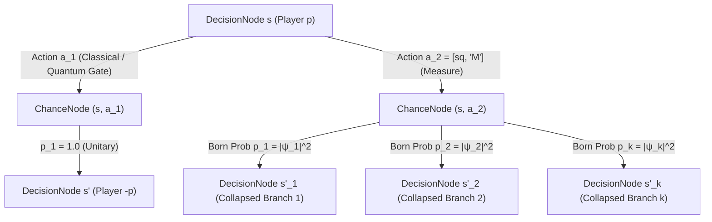
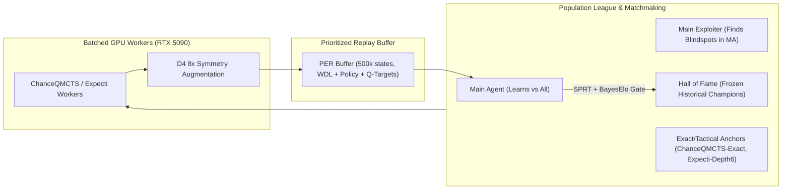

# Quantum Search & RL League Mathematical Architecture Specification

**Project**: `quantum_games_rl` (`quantum_games_rl_v2`)  
**Target Environments**:
- **TiqTaqToe** (`quantumness=3` / `QUANTUM_V3`, 9-qutrit statevector $|\Psi\rangle \in (\mathbb{C}^3)^{\otimes 9}$)
- **Quantum Cheqqers** ($6 \times 6$, `startRows=2`, `quantumness=2` / `GameType.ENTANGLEMENT`, 18-qubit sparse entangled subsystems)
**Target Hardware**: Local NVIDIA RTX 5090 (32 GB GDDR7 VRAM) for offline League Training; sub-second CPU/GPU inference budget (`time_limit_ms=1500`) for tournament play.

---

## 1. Root-Cause Audit of Legacy Search & Training Failures

### 1.1 Why Standard Deterministic-Child MCTS Fails Under Born-Rule Measurement Collapse
In the legacy search implementation ([`src/search/q_mcts.py`](file:///home/stefano-troffa/Personal_proj/quantum_games_rl_v2/src/search/q_mcts.py#L218-L228)), node expansion iterates over `valid_actions` and immediately samples a single stochastic transition:

```python
# src/search/q_mcts.py:219-227
for act in valid_actions:
    next_env = node.state.clone()
    next_env.step(act, return_state=False)
    node.children[act] = MCTSNode(
        state=next_env, parent=node, action_taken=act, prior=probs[act]
    )
```

This creates three fatal pathologies in quantum games:

1. **Deterministic Post-Measurement State Freezing (`State-Freeze Bias`)**:
   - When `act == 45` (measurement in [`src/env/tictactoe.py`](file:///home/stefano-troffa/Personal_proj/quantum_games_rl_v2/src/env/tictactoe.py#L348-L369)) or when the 9th square is touched and triggers forced full-board projection ([`src/env/tictactoe.py`](file:///home/stefano-troffa/Personal_proj/quantum_games_rl_v2/src/env/tictactoe.py#L431-L453); [`local-tiqtaqtoe-server.js`](file:///home/stefano-troffa/Personal_proj/ETQG_2026/TiqTaqToe/local-tiqtaqtoe-server.js#L599-L620)), `next_env.step(act)` draws **one** random sample from the Born distribution via `measure_collapse` ([`src/env/tictactoe.py`](file:///home/stefano-troffa/Personal_proj/quantum_games_rl_v2/src/env/tictactoe.py#L716-L727)).
   - That single random post-collapse board is permanently frozen inside `node.children[act].state`. Every subsequent MCTS simulation traversing action `act` ([`src/search/q_mcts.py`](file:///home/stefano-troffa/Personal_proj/quantum_games_rl_v2/src/search/q_mcts.py#L63-L65)) evaluates that *single lucky or unlucky collapse branch* rather than the true Born expectation $\mathbb{E}_{k \sim p(\cdot|s,a)}[V(s_k)]$.
   - Consequently, if an action has a $25\%$ chance of collapsing into an immediate win and a $75\%$ chance of collapsing into an immediate loss, and the single expansion sample hits the $25\%$ win branch, MCTS assigns $\hat{Q}(s,a) \to +1.0$ with $100\%$ certainty as $N(s,a) \to \infty$ (**optimism-under-collision bias**). Conversely, if a $75\%$ winning measurement collapses poorly on the first sample, MCTS permanently prunes it.

2. **Action-Space Collapse of Distinct Component Measurements**:
   - In [`local-tiqtaqtoe-server.js`](file:///home/stefano-troffa/Personal_proj/ETQG_2026/TiqTaqToe/local-tiqtaqtoe-server.js#L450-L454) and [`doMove`](file:///home/stefano-troffa/Personal_proj/ETQG_2026/TiqTaqToe/local-tiqtaqtoe-server.js#L579-L588), a measurement move `[sq, 'M']` measures **only the connected entangled component** (`roundState.pairs[pairIndex]`) containing `sq`.
   - By contrast, [`src/env/tictactoe.py`](file:///home/stefano-troffa/Personal_proj/quantum_games_rl_v2/src/env/tictactoe.py#L314-L317) and [`server.py`](file:///home/stefano-troffa/Personal_proj/quantum_games_rl_v2/server.py#L642-L649) collapse all `[sq, "M"]` moves into a single scalar action `45`, and [`server.py`](file:///home/stefano-troffa/Personal_proj/quantum_games_rl_v2/server.py#L766-L767) arbitrarily returns `selected_move[0]`, discarding which entangled pair should be selectively collapsed.

3. **Simulator Gate Mismatch at `quantumness=3`**:
   - In [`local-tiqtaqtoe-server.js`](file:///home/stefano-troffa/Personal_proj/ETQG_2026/TiqTaqToe/local-tiqtaqtoe-server.js#L482-L486), entangling an empty square `emptySquare` with a non-empty square `nonEmptySquare` applies `Shift(val)` on `emptySquare` and then `SqrtSwap()` with argument order `[nonEmptySquare, emptySquare]`.
   - In [`server.py`](file:///home/stefano-troffa/Personal_proj/quantum_games_rl_v2/server.py#L99-L137), `reconstruct_env_from_tournament` ignores `data['quantumState']` and fabricates synthetic `spooky_moves` over all pairs in `data['pairs']`, destroying the true complex amplitudes and relative phases of the 9-qutrit statevector.

---

### 1.2 Why Fixed-Depth Classical Minimax Failed in Quantum Cheqqers
In [`src/evaluate.py`](file:///home/stefano-troffa/Personal_proj/quantum_games_rl_v2/src/evaluate.py#L77-L184) and [`server.py`](file:///home/stefano-troffa/Personal_proj/quantum_games_rl_v2/server.py#L515-L558), the Cheqqers search exhibits four critical flaws:

1. **Broken Alpha-Beta Pruning Over Stochastic Quantum Jumps & Measurements**:
   - In [`src/evaluate.py`](file:///home/stefano-troffa/Personal_proj/quantum_games_rl_v2/src/evaluate.py#L94-L115), `minimax_cheqqers` calls `sim_env.step(action)` inside a deterministic Min/Max loop with $\alpha$-$\beta$ cutoffs.
   - In [`local-cheqqers-server.js`](file:///home/stefano-troffa/Personal_proj/ETQG_2026/Cheqqers/local-cheqqers-server.js#L545-L561), any move whose `landing` square is in quantum superposition (`0.001 < occ < 0.999`) triggers a projective measurement (`this.measureSquare(sqIdx)`):
     - With probability $p_{\text{occ}}$, the landing square collapses to `OCCUPIED`, **the move fails (`moveFailed = true`)**, and the turn passes immediately ([`local-cheqqers-server.js`](file:///home/stefano-troffa/Personal_proj/ETQG_2026/Cheqqers/local-cheqqers-server.js#L559-L601)).
     - With probability $1 - p_{\text{occ}}$, the landing square collapses to `EMPTY` (simultaneously collapsing entangled partner squares via [`factorOutEntity`](file:///home/stefano-troffa/Personal_proj/ETQG_2026/Cheqqers/local-cheqqers-server.js#L651-L685)) and the move succeeds.
   - Treating a random sample of `step(action)` as a deterministic child corrupts $\alpha$-$\beta$ bounds: a single lucky sample where a $50\%$ blocked landing square collapses to `EMPTY` causes an illegal $\beta$-cutoff, pruning safe deterministic moves.

2. **Turn-Alternation Assumption Violated by Multi-Jumps**:
   - In [`src/evaluate.py`](file:///home/stefano-troffa/Personal_proj/quantum_games_rl_v2/src/evaluate.py#L96) and [`L109`](file:///home/stefano-troffa/Personal_proj/quantum_games_rl_v2/src/evaluate.py#L109), `minimax_cheqqers` unconditionally flips `is_maximizing` (`True -> False` and `False -> True`) on every ply.
   - However, in [`local-cheqqers-server.js`](file:///home/stefano-troffa/Personal_proj/ETQG_2026/Cheqqers/local-cheqqers-server.js#L592-L593), multi-jump sequences keep `this.turn` unchanged (`this.multiJumpSquare = landing`) until no further captures exist from `landing` (or the piece was just crowned). Flipping `is_maximizing` mid-chain causes the search to assume the **opponent** chooses the next jump in the player's own multi-capture sequence!

3. **Maximum-Capture-Depth Filter Omission & Flying-King Rules**:
   - In [`local-cheqqers-server.js`](file:///home/stefano-troffa/Personal_proj/ETQG_2026/Cheqqers/local-cheqqers-server.js#L231-L240), `getPossibleMoves` filters capture moves by `calculateMaxCaptureDepth` (Italian/International draughts maximum-capture-path rule) and allows crowned kings to slide and capture at long range ([`local-cheqqers-server.js`](file:///home/stefano-troffa/Personal_proj/ETQG_2026/Cheqqers/local-cheqqers-server.js#L296-L341)).
   - The Python `Board._get_possible_moves` ([`src/env/checkers/board.py`](file:///home/stefano-troffa/Personal_proj/quantum_games_rl_v2/src/env/checkers/board.py#L98-L124)) only checks 1-step diagonals (`x ± 1, y ± 1`) even for crowned pieces and never filters by maximum capture depth, causing mismatches with tournament `legalMoves`.

4. **Destructive State Reconstruction in `server.py`**:
   - In [`server.py`](file:///home/stefano-troffa/Personal_proj/quantum_games_rl_v2/server.py#L537-L541), every square with `piece_color is not None` is forced to `ClassicalSquareState.OCCUPIED` with probability $1.0$, erasing `data['quantumStates']` and `sq['probability']` during search!

---

## 2. Exact Mathematical Formulation of Quantum Search Algorithms

### 2.1 Chance-Node Gumbel AlphaZero / PUCT MCTS (`src/search/chance_q_mcts.py`)

We formulate the quantum game tree as a two-player zero-sum **Stochastic Extensive-Form Game** with explicit **Decision Nodes** ($s \in \mathcal{S}$) and **Chance Nodes** ($(s, a) \in \mathcal{S} \times \mathcal{A}(s)$):



#### A. Exact Born-Rule Transition Decomposition
For any state $s$ and legal move $a \in \mathcal{A}(s)$, `env.get_move_outcomes(a)` returns the exact discrete Born distribution of post-move states:
$$\mathcal{O}(s, a) = \left\{ \left(p_k, s'_k\right) \right\}_{k=1}^{K}, \quad \sum_{k=1}^{K} p_k = 1, \quad p_k = \frac{\|\Pi_k U_a |\Psi(s)\rangle\|_2^2}{\|\,|\Psi(s)\rangle\,\|_2^2} > 0$$
- If $a$ is a purely unitary quantum move (`[sq1, sq2]`) or unmeasured classical move (`[sq]`) that does not fill the 9th square or trigger decoherence, $K = 1$ and $p_1 = 1.0$.
- If $a = [\text{sq}, \text{'M'}]$ or $a$ fills the 9th board square (`isBoardFull`), $K \le 2^4 = 16$ represents the exact joint projective measurement outcomes of the entangled component(s).

#### B. Exact Many-Worlds Endgame & Measurement Evaluation
In TiqTaqToe, any full-board collapse (or endgame with $\le 3$ empty squares) can be evaluated analytically via the **Many-Worlds Born Expectation** over the 9-qutrit statevector $|\Psi(s)\rangle = \sum_{b \in \{0,X,O\}^9} \psi_b |b\rangle$:
$$p_{\text{win}}(X \mid s) = \sum_{b : \text{winner}(b) = X} |\psi_b|^2, \quad p_{\text{win}}(O \mid s) = \sum_{b : \text{winner}(b) = O} |\psi_b|^2, \quad p_{\text{draw/both}}(s) = \sum_{b : \text{winner}(b) \in \{\text{DRAW}, \text{BOTH}\}} |\psi_b|^2$$
From the active player $p \in \{X, O\}$'s perspective, the exact full-projection expected value in $[-1, +1]$ is:
$$V_{\text{MW}}(s, p) = \begin{cases} p_{\text{win}}(X \mid s) - p_{\text{win}}(O \mid s) & \text{if } p = X \\ p_{\text{win}}(O \mid s) - p_{\text{win}}(X \mid s) & \text{if } p = O \end{cases}$$

Furthermore, when expanding a measurement ChanceNode $(s, a)$ with $K \le 8$ outcomes (or when remaining empty squares $\le 3$), we compute the **exact Born-weighted expectation** across all $K$ outcomes:
$$V_{\text{exact}}(s, a) = \sum_{k=1}^{K} p_k \, V(s'_k, p)$$
eliminating sampling variance on measurement actions completely!

#### C. $D_4$ Dihedral Symmetry Group Equivariant Inference
The $3 \times 3$ TiqTaqToe board is invariant under the 8 symmetries of the dihedral group $D_4 = \langle r, f \mid r^4 = f^2 = e, f r f = r^{-1} \rangle$ (4 rotations $\times$ 2 reflections). Let $g \in D_4$ act on square indices $\{0,\dots,8\}$ via permutation $\pi_g$:
- **State Equivariance**: The 111-dim state vector $x(s) = [x_{\text{local}}(54) \,\|\, x_{\text{adj}}(36) \,\|\, x_{\text{prob}}(18) \,\|\, x_{\text{glob}}(3)]$ transforms via a precomputed permutation matrix $P_g \in \{0,1\}^{111 \times 111}$:
  - The 9 blocks of 6 local features permute via $\pi_g(i)$.
  - The 36 upper-triangle adjacency pairs $(i, j)$ ($i < j$) permute to $(\min(\pi_g(i), \pi_g(j)), \max(\pi_g(i), \pi_g(j)))$.
  - The 9 blocks of 2 marginal collapse probabilities permute via $\pi_g(i)$.
  - The 3 global context features remain invariant.
- **Policy & Value Group Averaging**: By evaluating all 8 symmetries in a single batched forward pass of shape `[8, 111]`, we obtain strictly $D_4$-invariant value predictions and $D_4$-equivariant policy logits:
  $$\bar{V}_\theta(s) = \frac{1}{8} \sum_{g \in D_4} V_\theta(P_g x(s)), \qquad \bar{\ell}_\theta(s, a) = \frac{1}{8} \sum_{g \in D_4} \ell_\theta\left(P_g x(s), \pi_g(a)\right)$$

#### D. Gumbel Sequential Halving at the Root & PUCT at Interior Decision Nodes
Standard Dirichlet noise at the root wastes simulations when the action space has up to 46 legal moves and simulation budgets are tight ($60\text{--}250$ simulations). Following **Gumbel AlphaZero** (Danihelka et al., ICLR 2022):
1. At the root DecisionNode $s_0$, we sample i.i.d. $\text{Gumbel}(0,1)$ noise $g(a)$ (or deterministic zero-noise in pure greedy tournament mode when `use_gumbel=False`) and select the top $M = \min(|\mathcal{A}(s_0)|, m_{\max})$ actions ranked by $g(a) + \bar{\ell}_\theta(s_0, a)$.
2. Across $\lceil \log_2 M \rceil$ phases of **Sequential Halving**, we allocate simulations uniformly among the active root candidates $C^{(r)}$, updating each candidate's score via the completed Q-value transformation:
   $$\sigma\left(\hat{Q}(s_0, a)\right) = c_{\text{visit}} + \max_{b \in \mathcal{A}(s_0)} N(s_0, b) \cdot \hat{Q}(s_0, a)$$
   and retaining the top $\lceil |C^{(r)}| / 2 \rceil$ candidates maximizing $g(a) + \bar{\ell}_\theta(s_0, a) + \sigma(\hat{Q}(s_0, a))$.
3. At interior DecisionNodes $s \neq s_0$, selection follows PUCT with first-play urgency (FPU) initialized to the parent's value estimate:
   $$a^* = \arg\max_{a \in \mathcal{A}(s)} \left[ Q(s, a) + c_{\text{puct}} \, \pi_\theta(a \mid s) \frac{\sqrt{\sum_b N(s, b)}}{1 + N(s, a)} \right]$$
4. At ChanceNodes $(s, a)$, if $K \le 8$ and all children are evaluated on expansion, their exact Born-weighted value is immediately backed up; on subsequent visits, the traversal selects outcome $k$ according to the deficit between target Born visits $p_k N(s, a)$ and actual visits $N(s, a, k)$:
   $$k^* = \arg\max_{k \in \{1,\dots,K\}} \left( p_k - \frac{N(s, a, k)}{1 + N(s, a)} \right)$$
   which deterministically matches the exact Born frequencies $N(s, a, k) / N(s, a) \to p_k$ at rate $\mathcal{O}(1/N)$ instead of $\mathcal{O}(1/\sqrt{N})$ Monte Carlo noise!

---

### 2.2 Iterative-Deepening Expecti-AlphaBeta for Quantum Cheqqers (`src/search/expecti_cheqqers.py`)

Quantum Cheqqers is a tactical game where forced capture chains (`calculateMaxCaptureDepth`), flying-king diagonals, and quantum split/merge/entangled captures create sharp tactical horizons that random rollouts fail to resolve. We formulate **Iterative-Deepening Expecti-AlphaBeta with Star1 Chance Pruning**:

#### A. Exact Turn-Aware Min/Max & Chance Recursion
Let $p_{\text{root}} \in \{\text{WHITE}, \text{BLACK}\}$ be the searching player, and for any state $s$, let $\tau(s) \in \{+1, -1\}$ be $+1$ if `s.current_turn == p_root` and $-1$ otherwise.
- Crucially, after a multi-jump leg, `s'.current_turn` **remains equal to `s.current_turn`**. Thus our recursion never blindly flips `is_maximizing`; it queries `env.current_turn` at every DecisionNode!
- For a DecisionNode $s$ at remaining depth $d$ with bounds $[\alpha, \beta]$:
  $$V(s, d, \alpha, \beta) = \begin{cases}
  \max_{a \in \mathcal{A}(s)} \text{ChanceValue}(s, a, d - 1, \alpha, \beta) & \text{if } \tau(s) = +1 \\
  \min_{a \in \mathcal{A}(s)} \text{ChanceValue}(s, a, d - 1, \alpha, \beta) & \text{if } \tau(s) = -1
  \end{cases}$$

#### B. Star1 Expectimax Chance-Node Pruning
For a ChanceNode $(s, a)$ with sorted Born outcomes $\mathcal{O}(s, a) = \{(p_1, s'_1), \dots, (p_K, s'_K)\}$ ($p_1 \ge p_2 \ge \dots \ge p_K$) and bounded evaluation range $[-V_{\max}, +V_{\max}]$:
- If $K = 1$ (deterministic transition), $\text{ChanceValue}(s, a, d-1, \alpha, \beta) = V(s'_1, d-1, \alpha, \beta)$.
- If $K > 1$, let $S_{<k} = \sum_{j=1}^{k-1} p_j v_j$ be the partial expectation accumulated before outcome $k$, and $R_{>k} = \sum_{j=k+1}^{K} p_j$ be the remaining probability mass after outcome $k$.
- Because any future outcome $j > k$ satisfies $-V_{\max} \le v_j \le +V_{\max}$, outcome $k$ only needs to be searched within narrowed child bounds $[\alpha_k, \beta_k]$ (**Ballard's Star1 pruning**):
  $$\alpha_k = \max\left(-V_{\max}, \; \frac{\alpha - S_{<k} - R_{>k} V_{\max}}{p_k}\right), \qquad \beta_k = \min\left(+V_{\max}, \; \frac{\beta - S_{<k} + R_{>k} V_{\max}}{p_k}\right)$$
  If $\alpha_k \ge \beta_k$, the remaining outcomes cannot shift the expectation inside $[\alpha, \beta]$, yielding an **exact mathematical cutoff** at the chance node!

#### C. Move Ordering & Zobrist/State-Hash Transposition Table
To maximize $\alpha$-$\beta$ and Star1 cutoffs:
1. **Transposition Table (TT)**: Keyed by `(env.get_state_hash(), env.multi_jump_square)` storing `(depth, flag, value, best_move)` where `flag` $\in \{\text{EXACT}, \text{LOWERBOUND}, \text{UPPERBOUND}\}$.
2. **Tactical Move Priority**:
   - **Tier 0**: Principal Variation / TT best move from the previous Iterative Deepening depth.
   - **Tier 1**: Forced captures (`is_take_move`), ordered by landing certainty $(1 - p_{\text{fail}})$ and central advancement.
   - **Tier 2**: Crowning / promotion moves reaching the back rank (`row == 5` for White, `row == 0` for Black).
   - **Tier 3**: Killer moves (quiet moves that caused a $\beta$-cutoff at the same ply).
   - **Tier 4**: Quantum split moves (`len(move) == 3`) that claim central squares or create dual advancement threats, and quantum merge moves that consolidate high-probability superpositions.
   - **Tier 5**: Classical quiet moves ordered by History Heuristic + advancement toward promotion.

#### D. Hybrid Leaf Evaluation
At depth $d = 0$ (Once all forced capture chains are resolved via capture extension so we never evaluate mid-jump!), leaf evaluation blends:
1. **Exact Quantum Material + Positional + Entanglement Heuristic** (`env.evaluate_state(p_root)`):
   - Probability-weighted material ($\sum_i p_i (w_{\text{man}} + w_{\text{king}} \mathbb{I}[\text{crowned}_i])$),
   - Forward advancement bonus, center control bonus, back-rank defense bonus, and mobility/coexistence advantage.
2. **Optional Calibrated Neural Value Network** ($V_\theta(s) \in [-1, +1]$ scaled to heuristic units):
   $$V_{\text{leaf}}(s) = (1 - \lambda_{\text{nn}}) \, V_{\text{heur}}(s) + \lambda_{\text{nn}} \, c_{\text{scale}} V_\theta(s)$$

---

## 3. RTX 5090 League Training Pipeline & Anti-Collapse Architecture

Training an RL agent solely via naive self-play or against a single fixed opponent (`calibrate_value_net.py:379` uses a fixed 60% rollout / 40% self-play mix without opponent diversity) leads to **cyclic policy collapse** (rock-paper-scissors cycles in quantum entanglement/measurement timing) and **value overfitting** to narrow state distributions.

 leveraging the local **NVIDIA RTX 5090 (32 GB VRAM)**, we design a **4-Tier Population-Based League Architecture**:



### 3.1 Four Structural Pillars Against Local Minima

1. **$D_4$ Dihedral Data Augmentation ($\times 8$ Sample Efficiency)**:
   - Every trajectory step $(s_t, \pi_t, z_t)$ in TiqTaqToe is expanded into 8 exact dihedral conjugates $\{(P_g s_t, \Pi_g \pi_t, z_t)\}_{g \in D_4}$ before insertion into the replay buffer, and $C_2$ left-right mirror reflection ($\times 2$) is applied in $6 \times 6$ Cheqqers.
   - This eliminates directional blindspots (e.g., an agent defending top-left forks but failing on bottom-right forks).

2. **Off-Policy Gumbel Completed-Q Policy Improvement**:
   - Instead of training the policy head on raw visit counts $\pi_{\text{visits}}(a) = N(s,a)/\sum_b N(s,b)$—which assigns zero probability to unvisited actions at low simulation budgets—we train via KL-divergence against the **Gumbel Completed Policy**:
     $$\pi_{\text{improved}}(a \mid s) = \text{Softmax}\left(\bar{\ell}_\theta(s, a) + \sigma\left(\hat{Q}(s, a)\right)\right)$$
     where unvisited actions $a$ with $N(s,a)=0$ use the network's mixed value estimate $\hat{Q}(s,a) = v_{\text{mix}}(s)$. This guarantees a strict policy improvement step even with 32–64 simulations per move.

3. **3-Role League Matchmaking (Main Agent, Main Exploiter, Hall-of-Fame + Tactical Anchors)**:
   - **Main Agent ($\theta_{\text{main}}$)** plays:
     - $35\%$ vs current self ($\theta_{\text{main}}$) with root Gumbel exploration,
     - $30\%$ vs **Hall-of-Fame (HoF)** frozen snapshots sampled via **Prioritized Fictitious Self-Play (PFSP)** weighted by $p_{\text{opp}}(i) \propto (1 - \text{win\_rate}(\theta_{\text{main}}, \theta_{\text{HoF}}^{(i)}))^2$, focusing training on historical opponents that still beat or draw the Main Agent,
     - $20\%$ vs **Tactical Anchors** (`ChanceQMCTSPlayer` with exact many-worlds solver in TiqTaqToe; `ExpectiCheqqersPlayer` at depth 5–6 in Cheqqers), ensuring the neural network never forgets sound tactical fundamentals,
     - $15\%$ vs **Main Exploiter ($\theta_{\text{exp}}$)**.
   - **Main Exploiter ($\theta_{\text{exp}}$)** trains *exclusively* ($100\%$) to maximize win-rate against the current $\theta_{\text{main}}$, exposing exploitable measurement habits or deterministic patterns. Whenever $\theta_{\text{exp}}$ achieves $> 60\%$ win-rate against $\theta_{\text{main}}$, a snapshot of $\theta_{\text{exp}}$ is injected into the Hall of Fame.

4. **Categorical WDL Value Head + KL Anchor + SPRT Promotion Gate**:
   - All models use decoupled Policy/Value backbones (`decoupled=True`) and 3-class **Win/Draw/Loss (`wdl=True`)** cross-entropy loss ([`src/models/mlp.py`](file:///home/stefano-troffa/Personal_proj/quantum_games_rl_v2/src/models/mlp.py#L54-L82), [`src/models/kan.py`](file:///home/stefano-troffa/Personal_proj/quantum_games_rl_v2/src/models/kan.py#L98-L126)), preventing value saturation around $\pm 1$ in high-variance quantum collapses.
   - A candidate checkpoint $\theta_{\text{cand}}$ replaces the tournament production weights **if and only if** it passes a **Sequential Probability Ratio Test (SPRT)** ($H_0: \Delta \text{Elo} = 0$, $H_1: \Delta \text{Elo} \ge +15$, $\alpha = \beta = 0.05$) across balanced P1/P2 matches against the current champion and Tactical Anchors, with zero illegal moves and $99\text{th}$-percentile latency $< 1500\text{ ms}$.
